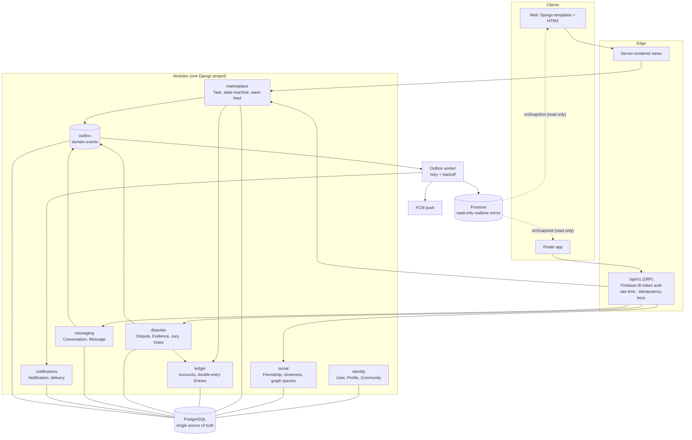
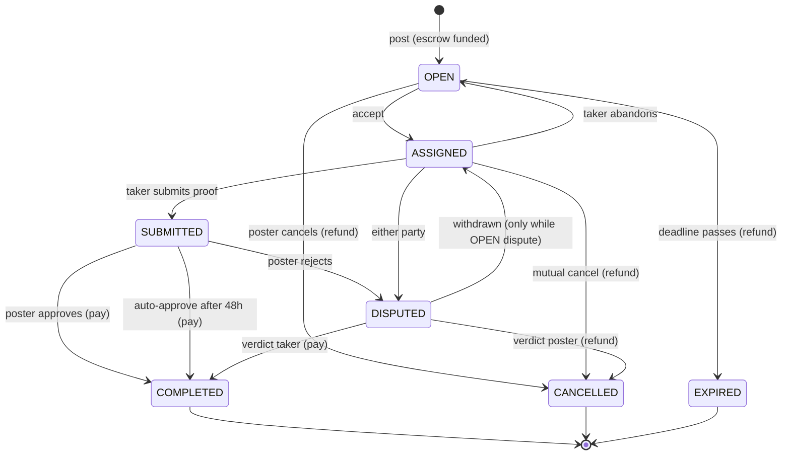
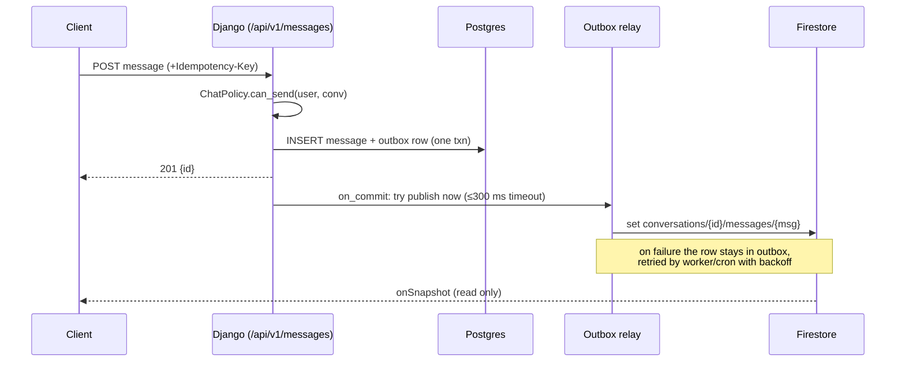

# LazyOne Architecture v2: Proposal

> Status: **Proposed**, 2026-10-31. Replaces [ARCHITECTURE.md](ARCHITECTURE.md), which no longer matches the code (it describes Channels + Redis; the code runs plain WSGI with Firestore).
> Scope: how LazyOne should be structured so it delivers the core idea (*hand small tasks to people you trust, for points, with fair dispute resolution*) correctly, cheaply, and in a way that can grow from one campus to many.

---

## 1. What LazyOne must guarantee

Taken from [Project Contract](Project%20Contract.md) and [REQUIREMENTS](REQUIREMENTS.md). Every design choice below serves one of these:

| # | Guarantee | Why it matters |
|---|-----------|----------------|
| G1 | **Points are never created or lost by accident.** Every point has an owner at all times. | The economy is the trust mechanism. One duplication bug kills it. |
| G2 | **A task has exactly one legal state at a time**, and moves only through legal transitions. | Prevents double-assignment, double-payout, and zombie disputes. |
| G3 | **Tasks reach the closest friends first, then spread outward ("waves").** | This is LazyOne's differentiator from a generic gig board. |
| G4 | **Disputes resolve fairly without the owner acting as judge.** | Required for "trust over each other" at 100+ users. |
| G5 | **One user's data is visible only to the people who should see it.** | Chats, phone numbers, and rooms are personal data. |
| G6 | **Runs at ₹0 to near-₹0** for one campus (~100 concurrent, ~5k users). | Budget constraint. |

---

## 2. Current-state audit (verified against `deployment` @ c683b3d)

### 2.1 Correctness / money bugs (break G1/G2)

| Sev | Where | Problem | Exploit / failure |
|-----|-------|---------|-------------------|
| 🔴 | [dispute.py:30-50](../../basic/views/dispute.py#L30-L50) | `withdraw_dispute` never checks `dispute.status`. | After a dispute is **resolved** (points already paid), the raiser withdraws it → task goes back to `in_progress` → poster completes it → **reward paid twice**. |
| 🔴 | [tasks.py:139-157](../../basic/views/tasks.py#L139-L157) | `accept_cancellation` refunds the poster **and** puts the task back to `available` with its reward still attached. | Next taker completes it → the poster's account pays nothing, taker receives `reward` → **points minted from nothing**. |
| 🔴 | [tasks.py:91-109](../../basic/views/tasks.py#L91-L109) | `complete_task` reads the task without `select_for_update`. | Double-click / two tabs → two transactions both see `in_progress` → **paid twice**. |
| 🔴 | [urls.py:42-50](../../basic/urls.py#L42-L50) | Every money-moving action (`take`, `complete`, `cancel`, `abandon`, `accept_cancellation`) accepts **GET**. | Any page containing `/">` triggers the action for a logged-in victim (CSRF does not cover GET). Link prefetchers also trigger it. |
| 🟠 | [tasks.py:175-219](../../basic/views/tasks.py#L175-L219) | `raise_dispute` re-opens a previously resolved/withdrawn dispute by mutating the same row. | Lose audit history. Combined with the withdraw bug, the dispute can be cycled indefinitely. |
| 🟠 | `UserProfile.rewards` | The balance is a mutable integer; `RewardLedger` is write-only decoration. Nothing enforces `balance == sum(ledger)`. | Every bug above silently corrupts balances with no way to detect it. |
| 🟡 | [chat.py:104](../../basic/views/chat.py#L104) | `redirect('chat_view', conversation_id=…)`, but the URL takes `public_id`. | `start_chat` always 500s (`NoReverseMatch`). |

### 2.2 Security / privacy (break G5)

| Sev | Where | Problem |
|-----|-------|---------|
| 🔴 | [chat.html:81-115](../../basic/templates/chat.html#L81-L115) | The browser **reads and writes Firestore directly** (`conversations/{id}/messages`). No `firestore.rules` exists in the repo, so access control depends on whatever is in the console. `ChatService.can_read/can_send` checks are bypassed by anyone with the JS SDK. The same message is also POSTed to Django, so there are **two diverging copies**. |
| 🔴 | [settings.py:29](../../LazyOne/settings.py#L29) | A fallback `SECRET_KEY` is committed to a **public** repo. If the env var is ever missing in production, sessions can be forged. |
| 🟠 | [backends.py:27](../../basic/backends.py#L27) | Users are keyed by `username=email`; the verified `firebase_uid` is never stored or checked. An email change at the provider creates a new account, and a re-used email inherits an old one. |
| 🟠 | [permissions.py:8-13, 78-79](../../basic/services/permissions.py#L8-L13) | Any logged-in user can read every dispute and every disputed chat. Access should be limited to parties, jurors and staff. |
| 🔴 | `master:.github/workflows/claim-jules-pr.yml` | `pull_request_target` + write token/PAT + `${{ github.head_ref }}` interpolated into a shell step is a script-injection risk. It also force-pushes re-authored bot commits. Delete or harden it. |
| 🟡 | — | No rate limiting on task posting, auth, or messages. No Firebase App Check. |

### 2.3 Structural problems (block G3/G6)

- **SQLite on Vercel** ([settings.py:129](../../LazyOne/settings.py#L129)): Vercel's filesystem is ephemeral and per-instance, so production data is lost or forked between instances. This is the single biggest blocker to real usage.
- **Firebase Admin initialised twice** ([models.py:14](../../basic/models.py#L14) and [settings.py:187](../../LazyOne/settings.py#L187)). Importing models has network side effects.
- **Duplicate settings blocks** (security headers at L74 and L214, allauth providers at L90 and L239).
- **Dead code that misleads contributors:** [routers.py](../../basic/routers.py) (`FriendsRouter` for a `friends_db` that is not configured), [consumers.py](../../basic/consumers.py) and [routing.py](../../basic/routing.py) (empty), plus `channels`, `daphne`, `channels_redis`, `cookiecutter`, and `django-tailwind` in requirements, all unused.
- **Business logic in views:** 226 lines of task state changes in [views/tasks.py](../../basic/views/tasks.py), with notifications created inline everywhere.
- **The core idea, "wave" distribution (G3), is not implemented.** Closeness is stored but only used to sort the friends list.
- **PR backlog:** 315 open PRs (almost all automated `stitch/*` branches proposing overlapping dispute/jury designs). See §9.
- **Split trunk:** `master` and `deployment` have diverged (23 vs 7 unique commits) with incompatible migration histories. #167 (dispute bonds) exists only on `master`; public IDs and ChatService only on `deployment`.

---

## 3. Target shape: a modular monolith

**Decision:** one Django deployable, split internally into bounded modules with explicit service APIs. **Not microservices.**

Why: at ~100 concurrent users, one Postgres box and one app process have orders of magnitude of headroom. Microservices would add network hops, distributed transactions (which are exactly what break G1), and hosting cost, for no benefit. The module boundaries below are drawn so that any module *could* be extracted later without a rewrite.



### Module rules

1. **Views and API endpoints only parse input, call one service method, and render the result.** They never touch `.status` or balances.
2. **A module writes only its own tables.** Cross-module effects go through the other module's service (`ledger.transfer(...)`) or a domain event.
3. **Only `ledger` changes balances. Only `marketplace.transitions` changes `Task.status`.** Grep-able and enforced by tests.
4. **No network I/O inside a DB transaction.** External effects (Firestore, FCM, email) are written to the outbox and run after commit.

Suggested layout:

```
lazyone/
  identity/   social/   marketplace/   ledger/
  disputes/   messaging/   notifications/   outbox/
  api/v1/          # DRF routers, serializers, auth class
  web/             # template views (thin)
  config/          # settings split: base.py, dev.py, prod.py
```

---

## 4. Core designs

### 4.1 Ledger: double-entry with escrow (G1)

Replace "mutable integer + decorative log" with an **append-only double-entry ledger**.

```
Account(id, kind ∈ {USER, ESCROW, SYSTEM_MINT, JURY_POOL}, owner_user?, task?, balance BIGINT, version)
Transfer(id, idempotency_key UNIQUE, reason, task?, created_at)
Entry(id, transfer_id, account_id, amount)  -- each Transfer's entries SUM to 0
```

| Event | Entries |
|-------|---------|
| Sign-up bonus | `SYSTEM_MINT −1500`, `user +1500` |
| Post task | `poster −R`, `escrow(task) +R` |
| Complete | `escrow −R`, `taker +R` |
| Cancel / refund | `escrow −R`, `poster +R` |
| Dispute bond (§4.5) | `party −B`, `escrow(dispute) +B` |

- `Account.balance` is a **cached** column, updated in the same transaction as its entries, with `CHECK (balance >= 0)` on USER and ESCROW accounts. Overdraft becomes a DB error instead of a bug.
- A single `ledger.transfer(entries, idempotency_key)` locks the involved accounts **in id order** (`SELECT … FOR UPDATE`), which avoids deadlocks.
- **Invariant test + nightly check:** `SUM(all entries) == 0` and `account.balance == SUM(entries for account)`. Any drift pages you.
- This makes the bugs in §2.1 structurally impossible. Example: completing a task whose escrow is empty fails on the CHECK constraint instead of minting points.

### 4.2 Task state machine (G2)

One table of legal transitions, one function that applies them.



```python
# marketplace/transitions.py
TRANSITIONS = {
    ("open", "accept"):        Rule(to="assigned",  actor=not_poster,  effects=[open_chat]),
    ("assigned", "submit"):    Rule(to="submitted", actor=taker),
    ("submitted", "approve"):  Rule(to="completed", actor=poster,      effects=[pay_taker]),
    ...
}

def apply(task_id, action, actor, *, idempotency_key):
    with transaction.atomic():
        task = Task.objects.select_for_update().get(pk=task_id)
        rule = TRANSITIONS.get((task.status, action)) or raise_illegal()
        rule.check_actor(task, actor)
        task.status = rule.to; task.version += 1; task.save()
        TaskEvent.objects.create(task=task, action=action, actor=actor, ...)  # audit trail
        for effect in rule.effects: effect(task)       # ledger calls, same txn
        outbox.emit("task.transitioned", task, action)   # side effects after commit
```

- **SUBMITTED state + auto-approve timeout** fixes the incentive gap where a poster never clicks "complete".
- `TaskEvent` gives a full audit history. Disputes and juries need it as evidence.
- All state-changing endpoints are **POST-only** and carry an `Idempotency-Key`, so retries from flaky mobile networks are safe.

### 4.3 Wave distribution (G3): the core idea

REQUIREMENTS says tasks should flow "from more close friend to the lesser closer friend in the form of wave". Design:

```
Wave 0 (t = 0)        friends with closeness ≥ 80
Wave 1 (t + 10 min)   friends with closeness ≥ 40
Wave 2 (t + 30 min)   all friends + friends-of-friends
Wave 3 (t + 2 h)      whole community (campus)
```

**Key decision: compute waves at query time, not with timers.**
`current_wave(task) = f(now − task.opened_at)` is a pure function, so the feed is one indexed query:

```sql
SELECT t.* FROM task t
JOIN audience a ON a.poster_id = t.poster_id AND a.viewer_id = :me
WHERE t.community_id = :community AND t.status = 'open'
  AND a.min_wave <= wave_of(now() - t.opened_at)
ORDER BY t.opened_at DESC LIMIT 30;
```

- `audience(poster_id, viewer_id, min_wave)` is a small precomputed table (rebuilt when friendships change; friends-of-friends capped at depth 2). Viewers with no row fall back to wave 3 (community-wide).
- The design needs **no scheduler, no fan-out writes, and no background job** to make a task visible, and it works on serverless.
- Push notifications per wave are the only timed part: the outbox worker emits `task.wave_reached` events at the wave boundaries.
- Posters can choose a policy: `friends_only`, `default_waves`, or `community_now` (urgent).
- The schedule is a config constant, so it can be tuned from real data (time-to-accept per wave).

### 4.4 Messaging and realtime (G5, G6)

**Decision:** PostgreSQL is authoritative. Firestore becomes a **server-written, client-read-only mirror**.



- **Firestore rules:** `allow write: if false;` everywhere. Reads are allowed only if `request.auth.uid in resource.data.member_uids` (written by the server, so it reflects `ChatPolicy`). For disputed tasks the server adds jurors' uids. Commit `firestore.rules` to the repo and deploy it in CI.
- Why not Django Channels + Redis now: it needs an always-on process plus Redis, and Firestore already gives free realtime fan-out and offline cache for Flutter. The publisher sits behind a `RealtimePublisher` interface, so moving to Channels later only swaps one adapter.
- The same pipe carries task-status updates, notification badges, and dispute vote tallies. This removes polling.

### 4.5 Disputes and jury (G4)

The 300+ open PRs explore this heavily (bonds, juror selection, voting). The consolidated design:

1. **Raise:** either party, while ASSIGNED/SUBMITTED. Both parties post a **bond** into dispute escrow, using the semantics already merged in #167 on `master`: `max(20% of reward, 50 pts)`, refunded to the winner and forfeited by the loser. This discourages frivolous disputes.
2. **Evidence window (24 h):** each side submits text/images (`DisputeEvidence`, append-only).
3. **Jury selection:** 5 jurors drawn randomly from the same community, **excluding anyone within 2 hops** of either party in the social graph (conflict of interest) and anyone with an open dispute. Draw with a seeded RNG recorded on the dispute, so selection is auditable.
4. **Vote (24 h):** commit-reveal is overkill at this scale; votes are hidden until the window closes. Majority wins; a tie or quorum < 3 escalates to a moderator.
5. **Settle (one ledger transfer):** winner gets the reward or refund plus their bond back. The loser's bond goes to `JURY_POOL` and is split among jurors who voted with the majority.
6. A new `Dispute` row is created each time; disputes are never re-opened by mutation.

### 4.6 Communities: data partitioning and routing (G5, G6)

"Routing clients' data" is solved by **tenancy, not by servers**:

- New `Community` model (a campus or hostel cluster). Users join via a verified email domain (`@iitj.ac.in`) or an invite.
- Every marketplace, dispute, and notification row carries `community_id`. A custom manager enforces `for_community(request.community)` by default, and composite indexes start with `community_id`.
- **Scale path:**
  - **Today:** one Postgres, filtered by `community_id`.
  - **At ~50 communities:** Postgres row-level security, plus read replicas for feeds.
  - **Only if ever needed:** shard by `community_id` (the routing key already exists everywhere, so this is a config change, not a rewrite).
- This also fixes the abandoned `FriendsRouter` idea. Splitting by *model* across databases breaks foreign keys and transactions; splitting by *tenant* does not.

### 4.7 Identity

- Key users by **`firebase_uid`** (unique, non-null). Email is an attribute.
- One `FirebaseAuthentication` class serves both DRF (Bearer token) and session login for the web.
- Verified flags (`email_verified`, `phone_verified`) come from token claims, not from client POSTs.
- Initialise Firebase once in `AppConfig.ready()`, with the credentials JSON from an env var (no file on disk in production).

### 4.8 Notifications

`domain event → outbox → NotificationService` decides the recipients, inserts a `Notification` row, then delivers via the Firestore badge plus FCM push. Views never create notifications.

---

## 5. Data model v2 (summary)

| Module | Tables |
|--------|--------|
| identity | `User` (firebase_uid), `Profile`, `Community`, `Membership(user, community, role)` |
| social | `FriendRequest`, `Friendship(user_a<user_b, closeness_a, closeness_b)` (one row per pair), `Audience(poster, viewer, min_wave)` |
| marketplace | `Task(+community, opened_at, version, wave_policy, reward)`, `TaskEvent`, `Submission` |
| ledger | `Account`, `Transfer`, `Entry` |
| disputes | `Dispute`, `DisputeEvidence`, `JurorAssignment`, `Vote` |
| messaging | `Conversation(+member_uids cache)`, `Message` |
| notifications | `Notification`, `DeviceToken` |
| outbox | `OutboxEvent(id, topic, payload, status, attempts, next_attempt_at)` |

---

## 6. Platform and deployment

| Concern | Choice | Notes |
|---------|--------|-------|
| DB | Managed Postgres (free tier: Neon / Supabase) | Fixes the SQLite-on-serverless data loss. |
| App | Keep Vercel **or** move to an always-on container (Render / Fly / Railway / a free-tier VM) | Vercel works with this design (no websockets needed). The outbox retry then runs as a Vercel Cron hitting `/internal/outbox/drain`. An always-on host lets you run a real worker. |
| Realtime | Firestore (read-only mirror) | §4.4 |
| Secrets | Env vars only; `SECRET_KEY` has **no default** in prod settings | Startup fails loudly if one is missing. |
| Static | WhiteNoise | |
| Observability | Structured JSON logs, Sentry (free tier), `/healthz` | |
| CI | GitHub Actions: ruff, `manage.py check --deploy`, pytest (incl. ledger invariants + concurrency tests on Postgres service container), deploy `firestore.rules` | |

---

## 7. Migration plan

Each phase ships on its own and keeps the app working.

| Phase | Goal | Work | Exit criteria |
|-------|------|------|---------------|
| **0. Stop the bleeding** (≈1–2 days) | One trunk, no money bugs, no data loss | Unify `master` + `deployment` into one trunk (port #167 + public IDs, rebuild migrations once). Delete or harden `claim-jules-pr.yml`. Fix the 🔴 bugs in §2.1 (POST-only, `select_for_update` in complete, status check in withdraw, take #28 for `accept_cancellation`). Remove the default `SECRET_KEY`. Fix `start_chat`. Move to Postgres. Commit `firestore.rules`. Delete dead code. Close the duplicate PRs. Add a CI test job. | Regression test per bug; `check --deploy` clean; CI green |
| **1. Ledger + state machine** (≈3 days) | G1, G2 enforced by structure | `ledger` module + data migration that opens accounts from current balances and escrows for in-flight tasks. `marketplace.transitions`. SUBMITTED state. `TaskEvent`. | Invariant tests green; zero direct writes to balance/status outside the two modules |
| **2. Outbox + messaging** (≈2 days) | G5 | Outbox table + relay; server-only Firestore writes; read-only rules; notifications via events | Client cannot write Firestore (rules test); chat survives Firestore outage |
| **3. API v1 + communities** (≈3 days) | Flutter-ready, multi-campus | DRF, Firebase auth class, idempotency middleware, rate limiting, `Community` scoping | Flutter can do full task lifecycle via API |
| **4. Waves** (≈2 days) | G3 | `Audience` table, feed query, wave notifications, poster policy | Metrics: time-to-accept per wave |
| **5. Jury disputes** (≈3 days) | G4 | Bonds, evidence, conflict-free juror draw, settlement | End-to-end dispute test incl. ledger invariant |

---

## 8. What "optimal" means here (non-goals)

- **No microservices, Kafka, or Kubernetes.** None of them help at this scale, and each costs money and correctness.
- **No Redis until it is needed.** Postgres handles the outbox, sessions, and rate limits (via the cache table) at this volume.
- **No blockchain/escrow tokens.** A double-entry ledger with DB constraints gives the same guarantees.

---

## 9. PR backlog and review findings

See [PR_REVIEW_2026-10-31.md](../Development/PR_REVIEW_2026-10-31.md) for the full triage of the open PRs and the ideas worth keeping.

## 10. Open questions for the owner

1. Wave timings and closeness thresholds: are the defaults above right for your campus?
2. Bond size for disputes: a flat amount or a % of the reward?
3. Hosting: stay on Vercel (cron-based outbox retry) or move to an always-on host?
4. Should points ever be purchasable or redeemable? (That changes the regulatory picture; recommend **no** for v2.)
